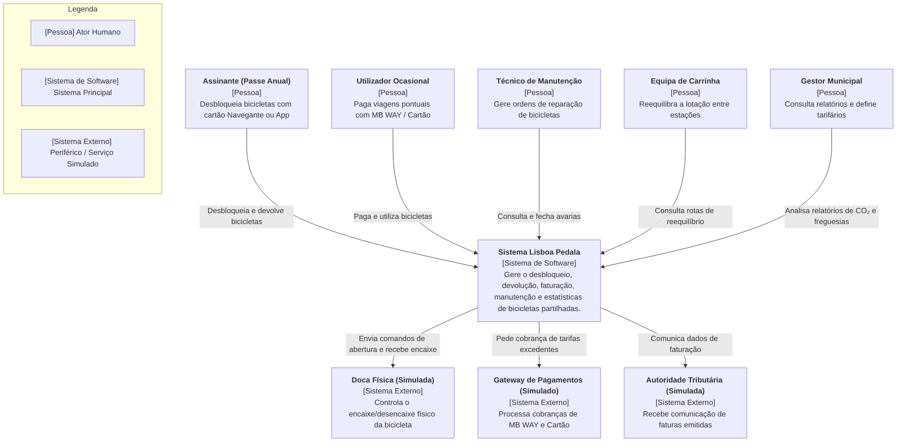
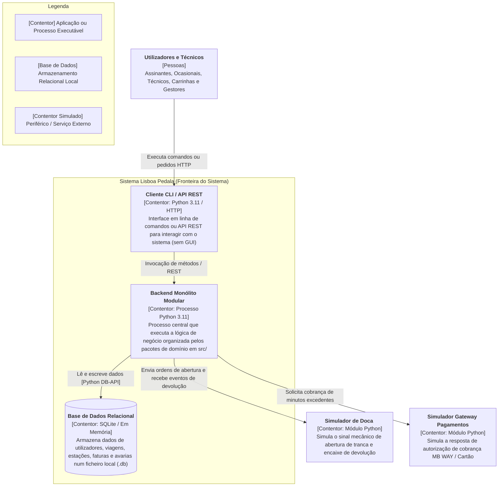
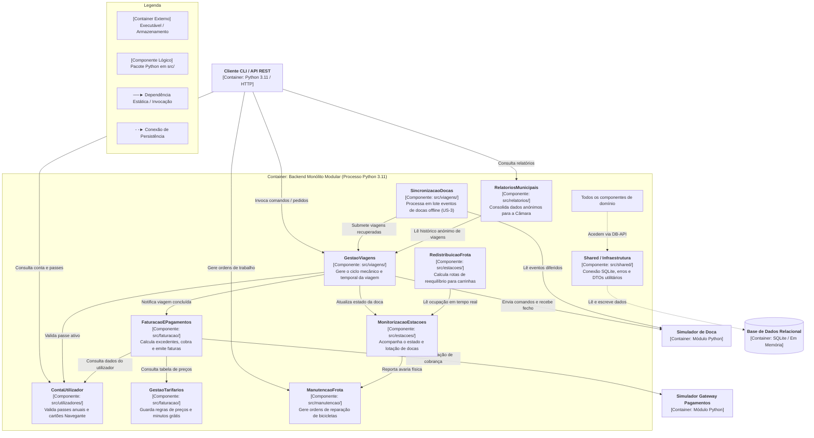

# Diagramas C4 - Níveis 1 a 3

Este documento contem a arquitetura do sistema **Lisboa Pedala** através do modelo C4 (Níveis 1 a 3). O objetivo é mostrar a estrutura da aplicação com diferentes graus de detalhe, desde a interação com os utilizadores até à organização interna do código.

A documentação divide-se em três níveis progressivos de abstração: 
- **Nível 1: Diagrama de Contexto (*System Context*)** - apresenta o sistema como um todo no centro da operação, identificando os 5 perfis de utilizadores (assinantes, ocasionais, técnicos, equipa de carrinha e gestores) e a ligação aos serviços externos simulados (docas IoT e pagamentos);
- **Nível 2: Diagrama de Contentores (*Containers*)** - mostra onde o sistema corre na prática, detalhando o cliente de interface (CLI / API REST), o processo central em Python 3.11 e a base de dados local em SQLite; 
- **Nível 3: Diagrama de Componentes (*Components*)** - faz um *zoom* sobre o servidor para ilustrar a interação entre os 9 componentes lógicos na pasta `src/` durante o fluxo principal da **US-1** (`Desbloquear → Devolver → Cobrar`).

## Diagrama C4 - Nível 1

---
## Diagrama C4 - Nível 2

---
## Diagrama C4 - Nível 3

